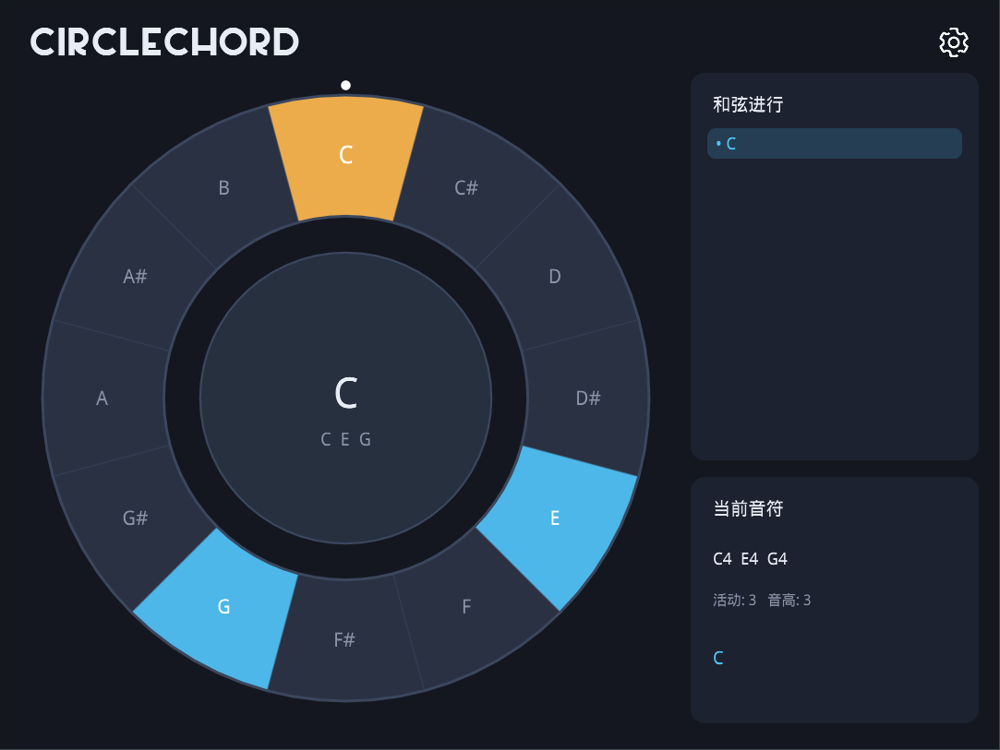
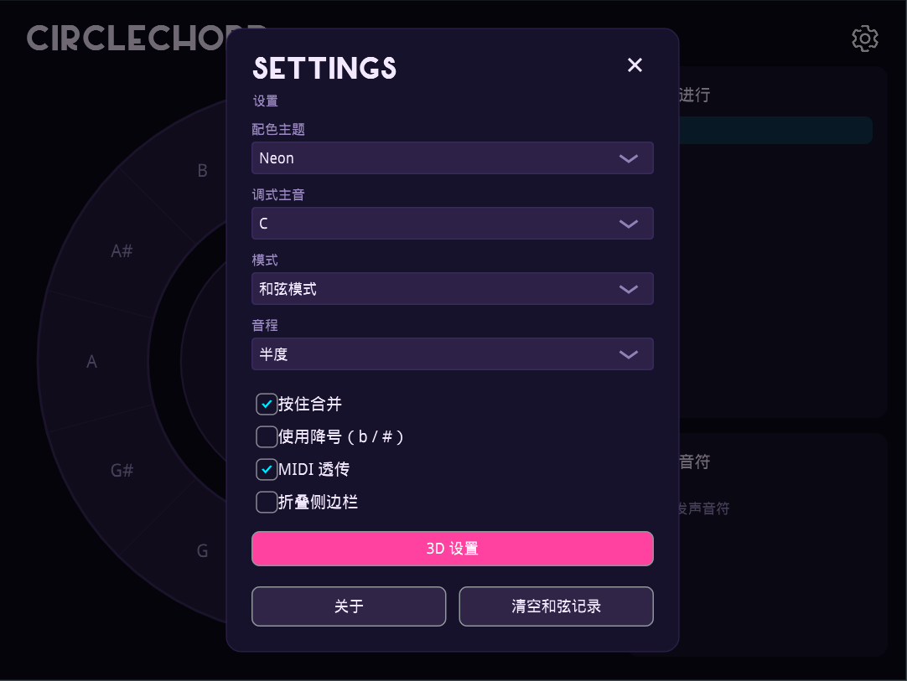
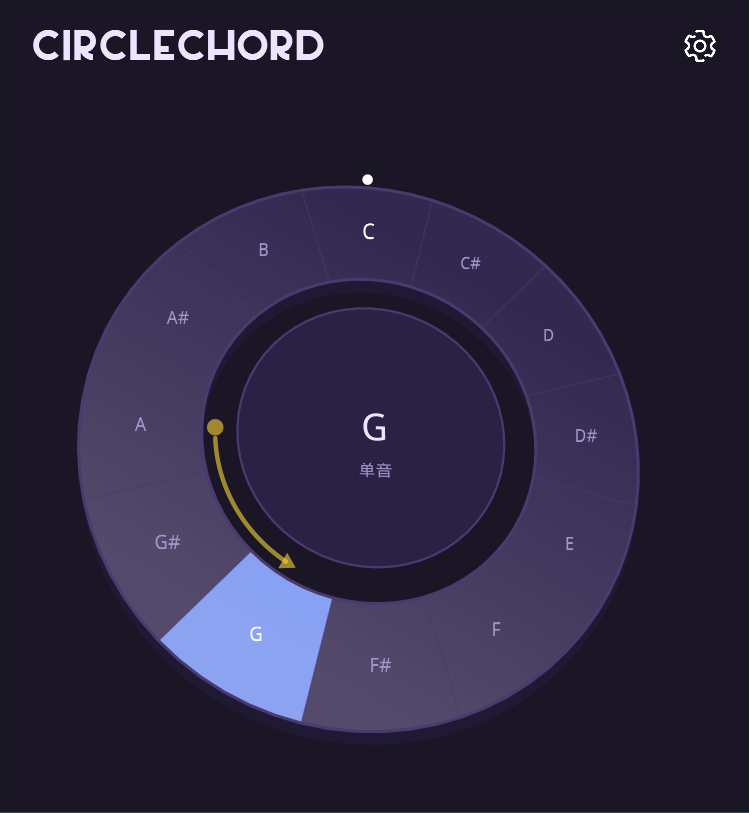

# CircleChord

A JUCE-based MIDI chord-detection VST3 plugin. It recognizes chords in real time and renders the active notes and chord on a circular diagram; when the chord changes, a fading arc arrow indicates the direction of the progression. A non-profit, personal/educational project.





## Features

- **Real-time MIDI detection** — receives MIDI notes (including notes played from the FL Studio piano roll), deduplicates them, and analyzes them by pitch class.
- **24 chord types**
  - Triads: major / minor / augmented / diminished / sus2 / sus4 / power chord (5)
  - Sevenths: maj7 / m7 / 7 / dim7 / m7b5 / maj6 / m6 / 7sus4
  - Extensions: add9 / madd9 / maj9 / m9 / 9 / 11 / maj13 / m13 / 13
- **Inversion detection** — slash chords are shown automatically when the lowest note is not the root, e.g. `C/E`.
- **Two working modes** — chord mode and melody mode.
- **Two circle layouts** — Circle of Fifths (C at the top, ascending by perfect fifths clockwise) and a chromatic layout.
- **3D tilt effect** — the entire diagram (ring, arrows, note names, and center text) tilts in perspective toward the active note, with three strength levels and optional highlight and thickness.
- **Transition arrow** — drawn along an arc from the previous chord to the current one.
- **Progression panel** — lists the recent chord sequence on the side, with the latest entry highlighted.
- **5 built-in themes** — Midnight / Neon / Paper / Dusk / Warm.
- Sharp/flat preference, MIDI pass-through toggle, and history clearing.
- Fonts are bundled into the binary for consistent cross-machine rendering.

## Installation (Windows)

1. Copy the whole `CircleChord.vst3` folder to your VST# folder (e.g.`C:\Program Files\Common Files\VST3\`).
2. In the FL Studio plugin manager, run **Refresh plugin list** (fast scan).
3. Load it as an instrument in the channel rack (it provides a piano roll and receives MIDI).
4. Play or sequence notes to see the chord and transition arrow.

The plugin is declared as a synth but produces no audio output (the output is silenced); use it as a visual analyzer alongside an instrument.

## Building from source

Requirements: CMake ≥ 3.20 and a C++17 compiler. JUCE is pulled in automatically through CMake and is expected at the sibling path `../JUCE`.

Windows (Visual Studio):

```
cmake -B build -G "Visual Studio 18 2026"
cmake --build build --config Release
```

Other platforms / generators:

```
cmake -B build -DCMAKE_BUILD_TYPE=Release
cmake --build build -j
```

The build produces both a VST3 bundle and a Standalone executable.

## Project structure

```
Source/
├── PluginProcessor.*   MIDI handling, detection scheduling, parameter persistence
├── PluginEditor.*      UI layout, theme switching, settings and history panels
├── ChordDetector.*     Chord templates and matching algorithm
├── CircleOfFifths.*    Circular rendering, 3D tilt projection, transition arrow
├── ChordHistory.*      Thread-safe chord history
├── Theme.*             Color themes and note/chord name helpers
├── AppFonts.h          Bundled font loading
└── JuceHeader.h        Aggregated module header
```

## Declaration
- This project is completed with AI assistance by only one person, and it is unlikely to be frequently maintained and modified.
- Currently this project only supports Chinese.
- The testing scope of this project is limited, and there may be unknown bugs on your device.
- This project only supports Windows.

## License

CircleChord is licensed under the **GNU General Public License v3.0** — see [`LICENSE`](LICENSE). It is built on the JUCE framework, which is dual-licensed under commercial or GPL v3 terms.

---

# CircleChord（中文）

基于 JUCE 的 MIDI 和弦检测 VST3 插件。它实时识别当前和弦，并把激活音符与和弦呈现在环形图上；和弦切换时用渐隐的弧形箭头表示进行方向。非盈利的个人/学习项目。


## 功能

- **实时 MIDI 检测**：接收 MIDI 音符（含 FL Studio 钢琴窗播放的音符），自动去重并按 pitch class 分析。
- **24 种和弦类型**
  - 三和弦：大 / 小 / 增 / 减 / sus2 / sus4 / 强力和弦（5）
  - 七和弦：maj7 / m7 / 7 / dim7 / m7b5 / maj6 / m6 / 7sus4
  - 扩展和弦：add9 / madd9 / maj9 / m9 / 9 / 11 / maj13 / m13 / 13
- **转位识别**：最低音非根音时自动显示 slash 和弦，如 `C/E`。
- **两种工作模式**：和弦模式与旋律模式。
- **两种圈布局**：五度圈（C 在顶部，顺时针按纯五度排列）与半度圈（半音阶）。
- **3D 倾斜效果**：整个画面（环、箭头、音名、中心文字）朝激活音方向透视倾斜，提供三档强度，可选高光与厚度。
- **进行箭头**：沿圆弧从上一和弦指向当前和弦。
- **和弦进行面板**：在侧栏列出最近的和弦序列，最新一条高亮。
- **5 套内置主题**：Midnight / Neon / Paper / Dusk / Warm。
- 支持升降号偏好、MIDI 透传开关与清空记录。
- 字体捆绑进二进制文件，跨机器显示一致。

## 安装（Windows）

1. 把整个 `CircleChord.vst3` 文件夹复制到您的VST3文件夹（如`C:\Program Files\Common Files\VST3\`）。
2. 在您的宿主软件中识别它。
3. 将其作为乐器在通道机架中加载（提供钢琴窗并接收 MIDI）。
4. 尝试弹奏或编写音符，查看效果。

插件被声明为合成器但不产生音频输出（输出已静音），可作为可视化分析器与发声乐器配合使用。

## 从源码构建

依赖 CMake ≥ 3.20 与 C++17 编译器。JUCE 通过 CMake 自动引用，预期位于同级目录 `../JUCE`。

Windows（Visual Studio）：

```
cmake -B build -G "Visual Studio 18 2026"
cmake --build build --config Release
```

其他平台 / 生成器：

```
cmake -B build -DCMAKE_BUILD_TYPE=Release
cmake --build build -j
```

构建会同时生成 VST3 bundle 与 Standalone 可执行文件。

## 目录结构

```
Source/
├── PluginProcessor.*   MIDI 处理、检测调度、参数持久化
├── PluginEditor.*      界面布局、主题切换、设置与历史面板
├── ChordDetector.*     和弦模板与匹配算法
├── CircleOfFifths.*    环形绘制、3D 倾斜投影、进行箭头
├── ChordHistory.*      线程安全的和弦历史
├── Theme.*             配色主题与音名/和弦名工具
├── AppFonts.h          捆绑字体加载
└── JuceHeader.h        模块聚合头

```
## 声明
- 该项目仅由一人使用AI辅助完成，大概不会经常维护修改。
- 目前该项目只支持中文。
- 该项目测试范围有限，可能在您的设备上有未知的bug出现。
- 该项目只支持Windows。

## 许可

CircleChord 基于 **GNU General Public License v3.0** 发布，详见 [`LICENSE`](LICENSE)。本项目构建于 JUCE 框架之上，JUCE 采用商业或 GPL v3 双许可。

